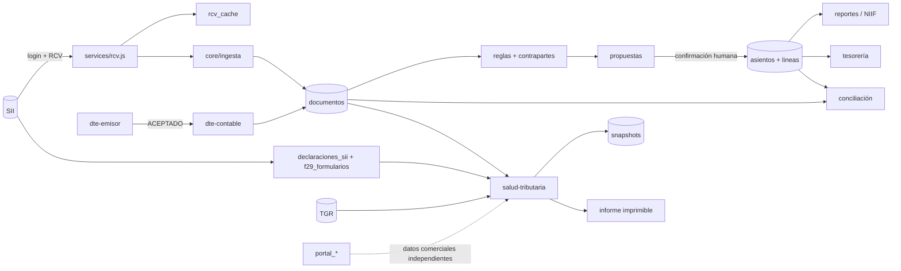

# 09 · Mapeo de datos y dependencias

> Fuente: `backend/db.js`, `backend/core/migraciones.js`, `CREATE TABLE` de los módulos y consultas de los `core/`.
> **61 tablas únicas**, declaradas en 48 sentencias del esquema base (`db.js` 14 + `core/migraciones.js` 34) y 16 sentencias en módulos que crean sus propias tablas (CRM 3 + CRM comercial 7, jobs 1, portal 3, rate-limit 1, `routes/portal.js` 1); la diferencia entre 64 declaraciones y 61 tablas son re-creaciones idempotentes de la misma tabla.

---

## 1. Grupos de tablas y propósito

### 1.1 Identidad, acceso y plataforma

| Tabla | Propósito | Claves / relaciones |
|---|---|---|
| `users` | Usuarios del sistema | `id`, `username` único, `password_hash` scrypt, `is_admin`, `activo`, `debe_cambiar_clave` |
| `sessions` | Sesiones server-side | `sid` único, `user_id` → users, `expires_at` |
| `roles` | Catálogo de roles | `codigo` único (`super_admin`, `contador`, …) |
| `usuario_empresa` | Asignación usuario↔empresa↔rol | PK (`usuario_id`,`empresa_id`), `rol_id` |
| `empresas` | Empresa/contribuyente | `rut` único entre activos, `clave_sii` **cifrada**, `tasa_ppm`, `exento`, `config_json` |
| `licencias` (`suscripciones`) | Plan y estado de la suscripción | `empresa_id`, estado, fechas, días |
| `pagos_suscripcion` | Pagos de la suscripción | `empresa_id`, pasarela, estado |
| `facturas_suscripcion` | DTE de la suscripción | `pago_id`, folio, estado |
| `webhook_eventos` | Idempotencia de webhooks | espacio evento/pago |
| `rate_limit` | Límites por clave/ventana | reemplaza el `Map` en memoria |
| `jobs_persistentes` | Jobs reanudables | `tipo`, `clave_unicidad`, `estado`, checkpoint |
| `auditoria` | Bitácora inmutable | `empresa_id`, `usuario_id`, `accion`, `entidad`, `antes_json`, `despues_json`, `ip` |
| `meta` | Claves internas | `rcv_cache_version`, etc. |

**Modelo dual heredado:** `clientes` (legacy, `clave_sii` en **texto plano**, scoping por `user_id`) coexiste con `empresas` (contable, clave cifrada, RBAC). No hay FK ni vínculo explícito entre ambas: comparten RUT por convención. Los informes legacy (`informes`, `informe_*`) cuelgan de `user_id`, no de `empresa_id`.

### 1.2 Contabilidad

| Tabla | Propósito | Relaciones |
|---|---|---|
| `cuentas` | Plan PUC por empresa | `empresa_id`, `codigo`, `clase`, `naturaleza`, `imputable`, `rubro_niif`, `alias` |
| `centros_costo` | Centros por empresa | `empresa_id` |
| `periodos_contables` | Períodos y cierre | `empresa_id`, `periodo`, `estado`, `cierre_json` |
| `asientos` | Cabecera de asiento | `empresa_id`, `folio`, `anio`, `fecha`, `tipo`, `origen`, `idempotencia`, `asiento_revertido_id` |
| `asiento_lineas` | Líneas (debe/haber) | `asiento_id`, `cuenta_id`, `centro_costo_id`, `debe`, `haber` INTEGER |
| `asientos_externos` | Dedupe de centralizaciones externas | UNIQUE (`empresa_id`,`idempotencia`) |
| `activos_fijos` | Activos y depreciación acumulada | `empresa_id`, `codigo` único, `cuenta_id`, estado |
| `activos_depreciaciones` | Depreciación mensual | UNIQUE (`activo_id`,`periodo`), `asiento_id` |

**Fuente de verdad de saldos:** `asiento_lineas` (derivada). No se persisten saldos; se agregan en consulta.

### 1.3 Documentos y tributario

| Tabla | Propósito | Relaciones |
|---|---|---|
| `documentos` | Bandeja única por empresa | UNIQUE (`empresa_id`,`clave_dedupe`); `estado`, `cuenta_id`, `regla_id`, `asiento_id`, `origen` (`sii`/`dte`), `periodo_ingesta` |
| `reglas_contables` | Reglas de clasificación | `empresa_id`, `prioridad`, `tipo_flujo`, `rut_contraparte`, `tipo_doc`, `cuenta_id`, `cuenta_contraparte_id` |
| `contrapartes` | Memoria RUT→cuenta | `empresa_id`, `rut`, `cuenta_id` |
| `propuestas` | Snapshot de asiento propuesto | `empresa_id`, `documento_id`, `estado`, `lineas_json` |
| `conciliaciones` | Resultado SII↔contable | `empresa_id`, `periodo` único, `resultado_json`, `diferencias` (conteo) |
| `rcv_cache` | JSON crudo del RCV | UNIQUE (`rut`,`periodo`,`tipo`), solo períodos cerrados |
| `rcv_agregados` | Boletas/comprobantes sin folio | `empresa_id`, `periodo`, tipos 39/41/48 |
| `declaraciones_sii` | F29/F22/BHE leídos del SII | UNIQUE (`empresa_id`,`tipo`,`periodo`) |
| `f29_formularios` | Formulario Compacto del F29 | `empresa_id`, `periodo`, `indicadores_json`, `verificaciones_json` |
| `salud_tributaria_snapshots` | Evidencia inmutable del informe | `empresa_id`, `periodo`, `datos_json` completo |
| `deuda_tgr` | Certificado TGR | `empresa_id`, total, fechas, PDF |
| `dte_config`, `dte_folios`, `dte_emitidos` | Emisor, CAF y DTEs | `empresa_id`; folios y certificado cifrados |

### 1.4 Tesorería y comercial

| Tabla | Propósito |
|---|---|
| `bancos_cuentas` | Cuentas bancarias con saldo inicial contabilizado |
| `teso_movimientos` | Movimientos con asiento; UNIQUE (`banco`,`asiento`) |
| `teso_cartola` | Líneas importadas (dedupe idempotente) |
| `teso_cartola_formatos` | Mapeos guardados por formato |
| `teso_aplicaciones` | Aplicación movimiento↔documento (1↔n) |
| `contactos_web` | Formulario público |
| `crm_*` (11) | Pipeline, recordatorios, campañas, fichas, contactos, prospectos, oportunidades, etapas, historial, actividades |
| `portal_*` (4) | Costos, cotizaciones, crédito, reportes guardados (datos comerciales del cliente, **no contables**) |
| `procesos`, `informes`, `informe_*` | Capa legacy de informes por rango |

---

## 2. Fuentes de verdad (una por concepto)

| Concepto | Fuente única | Réplicas / derivados | Riesgo |
|---|---|---|---|
| Empresa | `empresas` | `clientes` (legacy) | **Dual**: mismo RUT en dos tablas sin vínculo; la clave SII vive en ambas con distinto cifrado |
| Documento tributario | `documentos` (`clave_dedupe`) | `rcv_cache` (crudo), `rcv_agregados` (sin folio) | Correcto: RCV y DTE convergen en la misma clave |
| Asiento y saldos | `asientos` + `asiento_lineas` | Reportes calculados | Correcto |
| Clasificación | `reglas_contables` + `contrapartes` | `propuestas.lineas_json` (snapshot) | Correcto; el snapshot congela la decisión |
| Declaración F29 | `declaraciones_sii` **o** `f29_formularios` | Ambas se unen en `f29Historial` | **Doble lectura de la misma declaración**; mitigado por unión explícita y tests S13 |
| Ficha del contribuyente | `empresas` + `data/sii-fichas/<rut>.json` | JSON en disco | **Fuera de la BD**: no transaccional, backup separado |
| Deuda TGR | `deuda_tgr` + PDF en `data/certificados-tgr/` | — | Evidencia en disco; idem |
| Licencia | `suscripciones` | `empresas.licencia` en `/me` | Derivado |
| Auditoría | `auditoria` | — | Inmutable por convención (sin updates/deletes) |
| Jobs | `jobs_persistentes` | `Map` para jobs en curso | Los jobs de Salud/informes legacy no persisten |

---

## 3. Flujo de datos principal

---

## 4. Matriz de dependencias entre módulos

| Módulo | Depende de | Es dependencia de |
|---|---|---|
| Documentos | SII (RCV), reglas, contrapartes, cuentas | Contabilidad, Conciliación, Salud, Reportes, Tesorería (cobranza) |
| Contabilidad | cuentas, períodos, documentos, propuestas | Reportes, NIIF, Tesorería, Activos, Cierre, Salud (conciliación) |
| Impuestos/Salud | documentos, declaraciones_sii, f29_formularios, deuda_tgr, tesorería, renta, DJ, snapshots | Inicio (KPI), menú (pill), Informe |
| Tesorería | asientos, bancos, cartolas | Salud (liquidez/cobranza), Reportes (situación) |
| Activos | asientos, cuentas, períodos | Reportes (situación) |
| DTE | config/CAF, documentos, asientos | Contabilidad, Salud (ventas) |
| Reportes | asientos, NIIF, documentos | Centro de Reportes, Salud |
| Portal | documentos, portal_* (costos/cotizaciones) | — (read-only) |
| CRM | empresas, engagement (señales de sync/documentos/cierre) | — |
| Administración | empresas, usuarios, roles, suscripciones | Todo |

---

## 5. Dependencias técnicas transversales

| Dependencia | Consumidores | Riesgo si falla |
|---|---|---|
| `empresas.clave_sii` (bóveda) | SII, TGR, DTE | Sin clave no hay sync, ficha, declaraciones ni deuda |
| `data/sii-fichas/*.json` | Salud, onboarding | Diagnóstico sin identidad; el informe degrada a «sin ficha» |
| `data/certificados-tgr/*.pdf` | Deuda TGR | Se pierde la evidencia descargable |
| Chrome/Chromium + `puppeteer-core` | F29, F22, DJ, BHE, TGR | 424 `SII_SIN_NAVEGADOR`; el resto del sistema sigue |
| `rcv_cache` versión | Ingesta | Cambio de formato invalida caché |
| `jobs_persistentes` | Sync diaria, histórico | Pérdida de reanudación |
| `auditoria` | Todas las escrituras | Pérdida de trazabilidad |
| Zona horaria del servidor | `periodoActual()`, fechas | Un servidor en UTC puede cambiar de mes antes que Chile |

**Hallazgo:** el período «actual» se calcula con `new Date()` del servidor (`periodoActual()` en backend y frontend). Si el servidor corre en UTC, entre 21:00 y 00:00 de Chile el mes puede adelantarse. **No verificado** en producción; requiere confirmar `TZ`.

---

## 6. Integridad y aislamiento

| Control | Implementación | Cobertura |
|---|---|---|
| Aislamiento por empresa | `empresa_id` en todas las tablas de dominio + filtro en cada consulta + validación en core | Alta; tests por módulo |
| Dedupe de documentos | UNIQUE (`empresa_id`,`clave_dedupe`) | Alta |
| Idempotencia de asientos | UNIQUE parcial `empresa_id,idempotencia` | Alta |
| Idempotencia de jobs | UNIQUE (`tipo`,`clave_unicidad`,`estado`) + mutex | Alta |
| Inmutabilidad de asientos | Sin update/delete; reversión con asiento nuevo | Alta |
| Cierre de período | Check en `asientos.crear` + estado del período | Alta |
| FKs | Declaradas; `PRAGMA foreign_keys` debe estar activo por conexión | **Verificar en `db.js`** (no se confirma en esta lectura) |
| Borrado de usuarios | Protegido contra admin semilla y sí mismo | Alta |

---

## 7. Hallazgos de datos

| # | Hallazgo | Impacto | Recomendación |
|---|---|---|---|
| D-01 | **Modelo dual `clientes` / `empresas`** sin vínculo | Dos verdades para el mismo contribuyente; clave SII en texto plano en la legacy | Unificar por RUT con migración controlada; no borrar legacy hasta migrar informes |
| D-02 | **Datos críticos fuera de la BD** (ficha SII, PDF TGR) | Backup/restore incompleto si solo se respalda el `.db` | Incluir `data/sii-fichas` y `data/certificados-tgr` en el respaldo; documentarlo |
| D-03 | **F29 leído por dos vías** | Riesgo de divergencia entre Consulta Integral y Formulario Compacto | Ya se unen en el informe; agregar un chequeo de consistencia explícito y visible |
| D-04 | **`periodo_ingesta` vs `fecha_docto`** | El usuario puede filtrar por el mes equivocado | Etiquetar el filtro «Período tributario (RCV)» y ofrecer rango de emisión aparte |
| D-05 | **Cálculo de período con hora del servidor** | Cambio de mes prematuro | Fijar `TZ=America/Santiago` en despliegue |
| D-06 | **`conciliaciones.diferencias` es conteo, no arreglo** | La UI ya tuvo un bug por esto (`app.js` lo documenta) | Renombrar `diferencias_count` en la API y exponer el detalle |
| D-07 | **Portal guarda datos comerciales propios** | Podrían confundirse con contabilidad | Rotular «datos declarados por el cliente» en la UI |
| D-08 | **Tablas legacy con uso residual** (`procesos`, `informes` alimentan aún las vistas de «Lote del despacho») | Conviven dos modelos de informe y dos alcances (por `user_id` y por `empresa_id`) | Marcar como legacy, migrar las vistas y congelar escritura al terminar |

---

## 8. Consultas y agregaciones críticas (dónde mirar al cambiar algo)

| Cálculo | Archivo | Nota |
|---|---|---|
| Totales del libro con signo NC | `documentos.SIGNO_NC`, `services/calculos.sumarDocumentos` | Tipos 60/61 restan |
| IVA/PPM/F29 estimado | `services/calculos.js` | Fuente única |
| Cobertura RCV e ingresos por año | `salud-tributaria.docsPorPeriodo`, `ingresosPorAnio` | Excluye? Verifica estados; revisar si filtra ANULADO/ERROR |
| Conciliación declarado vs RCV | `salud-tributaria.construirInforme` | Usa `base_imponible` (563), no `total_debitos` (538) |
| Exposición | `construirInforme` | No suma ventas ni duplica deuda |
| Saldos contables | `asientos.mayor`, `reportes.*` | Naturaleza deudora/acreedora |
| Situación financiera | `reportes.situacion` | A = P + PN |
| NIIF | `niif.situacion` | `SIN_CLASIFICAR` visible |
| Edad de cartera | `tesoreria`/`cobranza` | DSO y tramos 15/30 |

**Advertencia:** las agregaciones de Salud usan `documentos` sin excluir explícitamente `ANULADO`/`ERROR` en `docsPorPeriodo`. Verificar si la bandeja guarda esos estados y si deben restar. `analitica` sí documenta excluirlos (test). Es un punto a validar con el contador.
