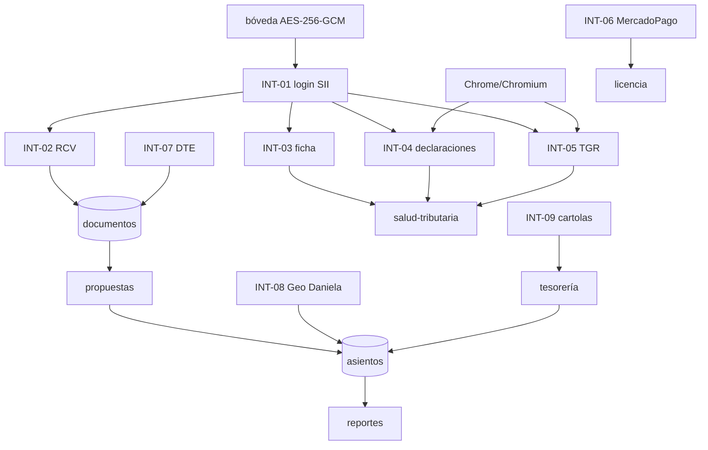

# 10 · Integraciones y conectores

> Todas las integraciones se inspeccionaron en código. **Ninguna se ejecutó contra el sistema externo en este handoff.**
> Estado: `Implementada` = código completo y pruebas con dobles; `Verificada previamente` = el repo documenta una corrida real (no reproducida aquí); `No verificada` = sin evidencia de corrida real.

---

## 1. Matriz general

| ID | Integración | Dirección | Protocolo | Módulo responsable | Estado | Riesgo |
|---|---|---|---|---|---|---|
| INT-01 | SII — autenticación | salida | HTTPS form + cookies | `services/sii-session.js` | Implementada / Verificada previamente | Alto: credencial y sesión |
| INT-02 | SII — RCV | salida | HTTPS JSON (`facadeService`) | `services/sii-rcv.js`, `rcv.js` | Implementada / Verificada previamente | Alto: fuente de documentos |
| INT-03 | SII — ficha del contribuyente | salida | HTTPS + parseo HTML (`DatosCntrNow`) | `core/empresas-sii.js` | Implementada | Medio |
| INT-04 | SII — declaraciones (F29, F22, DJ, BHE) | salida | Chrome headless + JSON/HTML/PDF | `core/declaraciones-sii.js`, `f29-formulario.js`, `renta-sii.js`, `dj-sii.js` | Implementada / Verificada previamente | Alto: dependencia de navegador y topes |
| INT-05 | TGR — deuda fiscal | salida | Chrome headless + PDF | `core/deuda-tgr.js` | Implementada / Verificada previamente | Alto: evidencia y autenticación |
| INT-06 | MercadoPago — pagos | bidireccional | HTTPS API + webhook | `core/pagos-mercadopago.js`, `routes/pagos.js` | Implementada | Medio: sin token no opera |
| INT-07 | DTE SII — emisión | salida | `@devlas/dte-sii` + HTTP | `core/dte-emisor.js` | Implementada; **producción pendiente de CAF/certificado** | Alto: folios y firma |
| INT-08 | Geo Daniela — asientos externos | entrada | HTTPS JSON | `core/asientos-externos.js`, `routes/asientos-externos.js` | Implementada | Medio: escritura contable externa |
| INT-09 | Cartolas bancarias | entrada | Archivo CSV/XLSX o pegado | `core/tesoreria-cartola-formatos.js` | Implementada; formatos por validar con muestras reales | Medio |
| INT-10 | SimpleAPI (proveedor RCV alternativo) | salida | HTTPS | `services/simpleapi.js` | Implementada, opcional (`RCV_PROVIDER`) | Bajo: no es el camino por defecto |
| INT-11 | Backups cifrados | salida | Archivo AES-256-GCM | `core/backup-cifrado.js` | Implementada | Alto si falta la clave |
| INT-12 | Webhook público de contacto | entrada | HTTPS form | `routes/contacto.js` | Implementada | Bajo (rate-limit + honeypot) |

---

## 2. INT-01 · Autenticación SII

| Campo | Detalle |
|---|---|
| Origen → destino | Backend → `zeusr.sii.cl` |
| Propósito | Obtener cookies de sesión del contribuyente para RCV y portales |
| Mecanismo | GET a la página de login (cookies de balanceador) → POST `application/x-www-form-urlencoded` a `CAutInicio.cgi` con RUT, DV y referencia; redirecciones manuales, cookies por salto |
| Credenciales | `empresas.clave_sii` descifrada desde bóveda (AES-256-GCM) |
| Validación de éxito | Presencia de cookies de sesión (`TOKEN`, `CSESSIONID`, `RUT_NS`, `DV_NS`, `NETSCAPE_LIVEWIRE.*`, `X-SII-STATE-*`) |
| Detección de clave incorrecta | Contenido de la respuesta («no es correcta», redirección a login) |
| Caché | `Map` por RUT con TTL 25 min (`TTL_MS`) |
| Cierre | `CAutCierra.cgi` / `autTermino.cgi` en `finally` (declaraciones y TGR) |
| Errores | Login rechazado, sin cookies de sesión, 401 posterior del facadeService |
| Riesgo | Tope de sesiones simultáneas del SII; dejar sesiones abiertas bloquea al cliente |
| Pruebas | `test/sii-sesion.test.js` con servidor simulado |

---

## 3. INT-02 · RCV (Registro de Compras y Ventas)

| Campo | Detalle |
|---|---|
| Endpoints | `.../facadeService/getDetalleCompraExport`, `getDetalleVentaExport`, `getResumen` |
| Autenticación | Cookie de sesión + `TOKEN`/`conversationId` del `getResumen` |
| Respuesta | CSV empaquetado en array JSON (`data[0]` encabezados `;`, `data[1..]` filas) |
| Paginación | `metaData.page.totalPages` / `pageNro` |
| Normalización | Folio, RUT contraparte, montos, tipo doc, fechas; `montos_sii_json` y `detalle_sii_json` conservados crudos |
| Rate limit | Global entre consultas (`INTERVALO_MS` de `simpleapi.js`) y reintento por sesión expirada |
| Caché | `rcv_cache` solo períodos cerrados, invalidada por `meta.rcv_cache_version` |
| Agregados | Boletas 39/41 y comprobantes 48: el SII entrega una fila por total; se guardan en `rcv_agregados` |
| Consumidores | Ingesta (bandeja), Libros, Salud, Analítica, Informes legacy |
| Riesgo | Si el SII cambia el formato del CSV o el namespace, la ingesta falla completa |
| Pruebas | `fase3`, `sync-diaria`, `resumenes-consistencia`, `sii-sesion` |

---

## 4. INT-03 · Ficha del contribuyente

| Campo | Detalle |
|---|---|
| Endpoint | `misiir.sii.cl/cgi_misii/siihome.cgi` (HTML con JSON `DatosCntrNow`) |
| Datos | Razón social, tipo/subtipo, inicio/término de giro, actividades, dirección, capital, atributos (régimen 14TT/14GG/14D1), email, teléfono, alertas |
| Persistencia | `empresas` (campos) + `data/sii-fichas/<rut>.json` (crudo) |
| Regla | Si el RUT de la ficha no coincide con el pedido, se rechaza |
| Fallback | Si la cuenta no habilita token RCV, se usa login básico para la ficha |
| Uso | Alta de empresa, onboarding, Salud Tributaria |
| Riesgo | Parseo de HTML frágil; cambios de maqueta rompen la extracción sin cambiar el contrato |
| Pruebas | `empresas-sii.test.js` (10 casos de parser/mapeo) |

---

## 5. INT-04 · Declaraciones SII (F29, F22, DJ, BHE)

| Sub-integración | Fuente | Método | Datos | Persistencia |
|---|---|---|---|---|
| F29 estado | `www4.sii.cl/sifmConsultaInternet` | Chrome headless; matriz mes×año por tooltip, «Buscar Formulario» | Estado, folio, fecha, monto | `declaraciones_sii` (UPSERT empresa/tipo/período) |
| F29 casillas | `rfiInternet/formCompacto?folio=` | Descarga PDF y extrae casillas (`pdf-parse` + texto) | Ventas, IVA, PPM, total, boletas, recibos | `f29_formularios` |
| Renta F22 | `consultaestadof22ui/services/data/facadeService/` | Fachada JSON con la sesión | Folio, concordancia, estado, remanente, eventos | `declaraciones_sii` tipo F22 |
| DJ | `perfilamientodjui/services/data/facadeService/` | Fachada JSON | Formulario, estado, folio, fechas, vencimiento | `declaraciones_sii` tipo DJ |
| BHE | `loa.sii.cl` CGI (SSO de la sesión) | HTML tablas anuales | Honorario bruto, retenciones, líquido (emitidas/recibidas) | `declaraciones_sii` tipo BHE |

**Reglas de operación**
- Una autenticación por corrida y cierre **siempre** al final (tope de sesiones).
- Si falta Chrome/Chromium o `puppeteer-core`, se responde 424 `SII_SIN_NAVEGADOR` **antes** de autenticar (no deja sesión abierta).
- Tope de sesiones → 409 `SII_TOPE_SESIONES` (no reintentar; cerrar sesiones).
- Fallo del SII → 502.
- Idempotente por UPSERT; repetir no duplica.
- Nada se inventa: sin dato ⇒ `sin_informacion`; sin consulta ⇒ `no_consultado`.

**Riesgo alto:** automatización de portales no oficiales. Un cambio de maqueta, un captcha o un bloqueo de IP detiene la función. El sistema lo declara, pero el usuario percibe «no funciona».

---

## 6. INT-05 · TGR — deuda fiscal

| Campo | Detalle |
|---|---|
| Flujo | `tgr.gob.cl/tramites-tgr/certificado-de-deuda-fiscal` → SSO SII (`www2.sii.cl/oauthsii-v1-org`) → token de trámite de un solo uso → app legada `CertDeudasRutCutAixWeb` |
| Credencial | La misma clave tributaria de la bóveda (no se piden credenciales nuevas) |
| Evidencia | PDF embebido (`data:application/pdf;base64`) guardado en `data/certificados-tgr/` + texto extraído con `pdf-parse` |
| Datos | Estado (`sin_deuda`/`con_deuda`), total rotulado, fecha de emisión, liquidada al, código de verificación, detalle por documento |
| Regla | Si el total no es legible, `total = NULL` y se conserva el PDF; **nunca** se suma a mano |
| UI | Pestaña en Salud y pestaña en Tesorería (duplicado) |
| Riesgo | Certificado es una foto: no incluye deuda posterior ni convenios; se declara en las limitaciones |

---

## 7. INT-06 · MercadoPago

| Campo | Detalle |
|---|---|
| Checkout | `POST /api/pagos/empresas/:id/checkout` con adaptador inyectable; sin `MP_ACCESS_TOKEN` el checkout queda deshabilitado |
| Webhook | `POST /api/pagos/webhook/mercadopago` **público**; idempotente en dos espacios (evento y pago) |
| Verificación | **Siempre** re-confirma el estado contra la API de la pasarela; la firma (`x-signature`) es adicional |
| Efecto | `activarPlan` en transacción auditada; el gate de licencia no aplica a pagar (una empresa suspendida puede reactivarse) |
| Riesgo | Webhook expuesto; depende de la disponibilidad de MP; sin secreto configurado se acepta la re-consulta como validación |

---

## 8. INT-07 · Emisión de DTE

| Campo | Detalle |
|---|---|
| Librería | `@devlas/dte-sii` (adaptador inyectable; real lazy) |
| Configuración | Certificado `.pfx` + contraseña y CAF XML **cifrados** en bóveda; resolución, giro, dirección, comuna, ACTECO, ambiente |
| Folios | Correlativo por empresa+tipo validado contra CAFs; hueco entre rangos → 422 nombrándolo |
| Documentos | 33, 34, 56, 61 (NC con CodRef 1/2/3 y referencia obligatoria) |
| Estado | Códigos SII **verbatim** (`sii_codigo`, `sii_respuesta_json`: EPR, RPR, DOK…); `estado` local es solo pipeline |
| Reintento | Mismo folio; idempotencia opcional por clave |
| Puente contable | DTE ACEPTADO → `documentos` (`origen='dte'`, misma `clave_dedupe`) → propuesta pendiente |
| Riesgo | Sin CAF/certificado no hay emisión; un certificado equivocado rompe todo hasta corregirlo |
| Pruebas | `dte-emision` (XML real offline con PKCS12+CAF generados), `dte-contable` |

---

## 9. INT-08 · Geo Daniela (asientos externos)

| Campo | Detalle |
|---|---|
| Contrato | `POST /api/contable/asientos-externos` con RUT de empresa + centralización |
| Auth | `permisoPorRut('asientos:crear')`: el usuario debe tener acceso a la empresa del RUT |
| Validaciones | Σdebe = Σhaber, ≥2 líneas, período abierto, códigos de cuenta existentes; rechazo **completo** 422 con lista de códigos inválidos |
| Idempotencia | Clave explícita o SHA-256 del payload; reenvío deduplicado |
| Resultado | Asiento tipo `externo` con folio correlativo, origen y auditoría |
| Auxiliar | `GET /asientos-externos/validar-codigos` sin crear cuentas |
| Riesgo | Un integrador externo puede introducir asientos; la protección es el RBAC por RUT y la validación estricta |

---

## 10. INT-09 · Cartolas bancarias

| Campo | Detalle |
|---|---|
| Entradas | Pegado de texto CSV o archivo (base64, límite 8 MB en esa ruta) |
| Formatos | Detección por encabezado o estructura estadística (con/sin fila de encabezado); mapeo manual guardado por nombre |
| Normalización | Montos chilenos (miles/decimales/paréntesis), fechas ISO/DD-MM/serial con rechazo de inexistentes |
| Persistencia | `teso_cartola` con dedupe idempotente; `movimiento_id` = match de conciliación |
| Límite | **No hay integración bancaria automática** (sin agregador); la conciliación es 1↔1 |
| Pruebas | `cartola-formatos` (12), `fase6` |

---

## 11. INT-10 · SimpleAPI (opcional)

Proveedor alternativo de RCV (`RCV_PROVIDER=simpleapi`) con `SIMPLEAPI_KEY`. El camino por defecto es `sii`. Se conserva por compatibilidad; no se verificó en esta pasada.

---

## 12. INT-11 · Backups

`core/backup-cifrado.js` cifra con AES-256-GCM (`JMVBACKUP1`) usando `BACKUP_ENCRYPTION_KEY`, separada de `SECRETOS_MASTER_KEY`. Si se pierde la clave, los backups no se pueden restaurar. El cron de backup y la verificación de escritura de `/app/data` están documentados en `ops/` y `docs/DESPLIEGUE.md`.

**Hallazgo operativo documentado (2026-10-17):** siete noches de backups fallidos por permisos de `data/backups` con `USER node`; se corrigió con `chown` y verificación en `ops/deploy.sh`. Es un recordatorio de que la integración con el sistema de archivos también es una dependencia crítica.

---

## 13. Dependencias entre integraciones

---

## 14. Riesgos de integración (resumen)

| ID | Riesgo | Probabilidad | Impacto | Mitigación actual | Mitigación propuesta |
|---|---|---|---|---|---|
| RK-I1 | Cambio de maqueta/endpoint del SII | Media | Alto (RCV/declaraciones) | Parseo tolerante, logs, tests con fixtures | Monitoreo sintético diario + alerta al admin |
| RK-I2 | Tope de sesiones SII | Media | Alto (bloqueo del cliente) | Cierre en `finally`, una sesión por corrida | Panel «sesiones abiertas» y botón de cierre |
| RK-I3 | Falta de Chrome en el servidor | Media | Medio (F29/F22/TGR no disponibles) | 424 explícito antes de autenticar | Chequeo de readiness en `/api/health` |
| RK-I4 | Credencial SII inválida | Alta (por datos) | Medio | Error claro, no borra ficha previa | Estado por empresa con último error y fecha |
| RK-I5 | Webhook MP falsificado | Baja | Alto | Re-consulta siempre a la API | Exigir firma en producción |
| RK-I6 | CAF/certificado ausente o erróneo | Media | Alto (no emite) | Validación al cargar; confirmación por RUT | Checklist de emisión visible |
| RK-I7 | Formato de cartola desconocido | Alta | Bajo | Mapeo manual guardado | Biblioteca de formatos por banco |
| RK-I8 | Pérdida de `BACKUP_ENCRYPTION_KEY` | Baja | Crítico | Variable separada | Custodia documentada y prueba de restauración periódica |
