# 15 · Diagramas Mermaid

> Convención: **línea continua** = conexión existente y verificada en código; **línea punteada** = propuesta o no verificada en ejecución.
> Los diagramas reflejan el repositorio al 2026-10-23; no incluyen integraciones inexistentes.

---

## 1. Arquitectura general

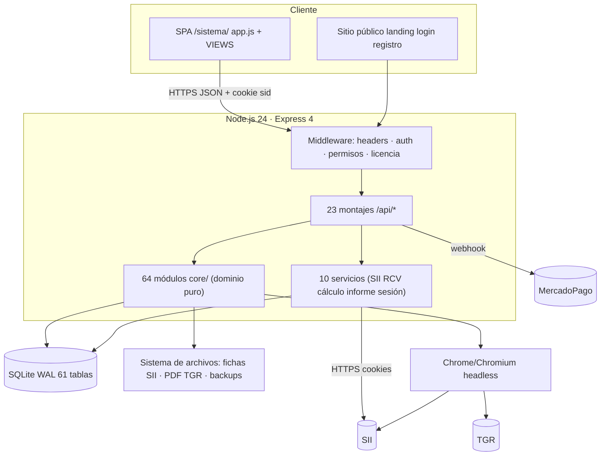

---

## 2. Mapa de módulos y subfunciones (actual)

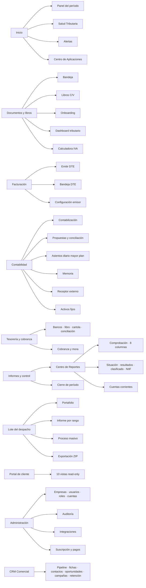

---

## 3. Navegación entre pantallas (actual)

```mermaid
flowchart TD
  LOGIN["Login"] --> BOOT{"¿Tiene empresa?"}
  BOOT -->|No| ONB["Onboarding RUT + clave SII"]
  BOOT -->|Sí| CENTRO["Centro de Aplicaciones #centro"]
  ONB --> CENTRO

  CENTRO --> PANEL["Panel del período"]
  CENTRO --> MODULOS["Cualquier módulo autorizado"]

  PANEL --> SALUD
  PANEL --> AUTOM
  PANEL --> LIBROS
  PANEL --> ONBOARD
  PANEL --> DOCS
  PANEL --> ASIENTOS
  PANEL --> PROPUESTAS
  PANEL --> REPORTES

  DOCS -->|clasificar| PROP["Propuesta"]
  PROP -->|confirmar| ASIENTO["Asiento"]
  LIBROS -->|ingesta SII| DOCS
  SALUD -->|reunir antecedentes| JOB["Job 6 pasos"]
  JOB --> SALUD
  SALUD -->|emitir| INFORME["Informe HTML imprimible"]
  SALUD -->|deuda TGR| CERT["Certificado PDF TGR"]
  TESO -->|cartola| CONC["Conciliación bancaria"]
  CIE -->|cerrar| PER["Período CERRADO"]
  DTE -->|ACEPTADO| DOCS
end
```

---

## 4. Flujo contable principal (documento → asiento)

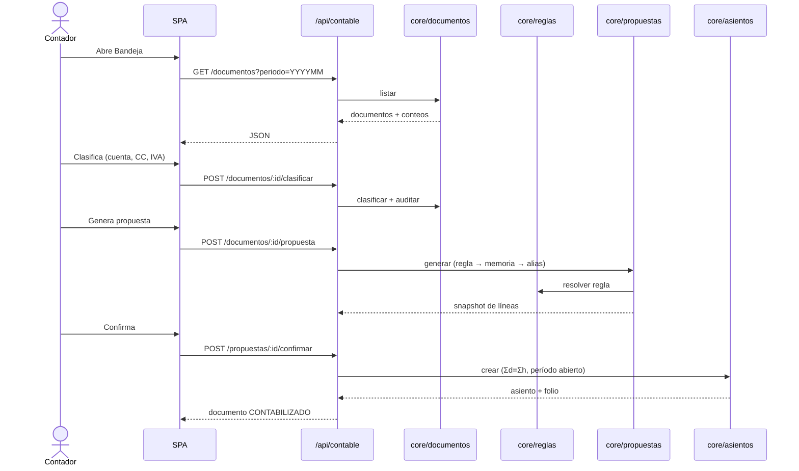

---

## 5. Integración SII

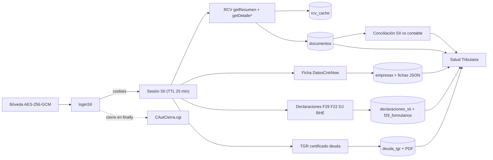

---

## 6. Generación de Salud Tributaria

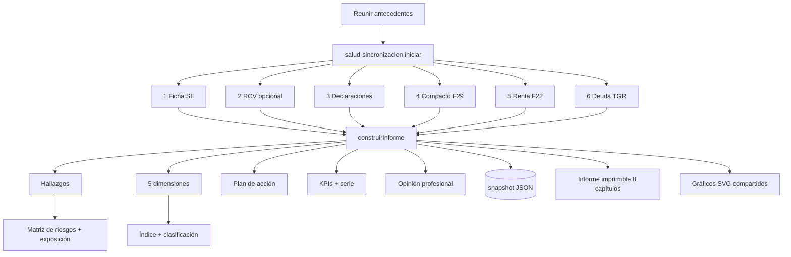

---

## 7. Generación de certificados y reportes

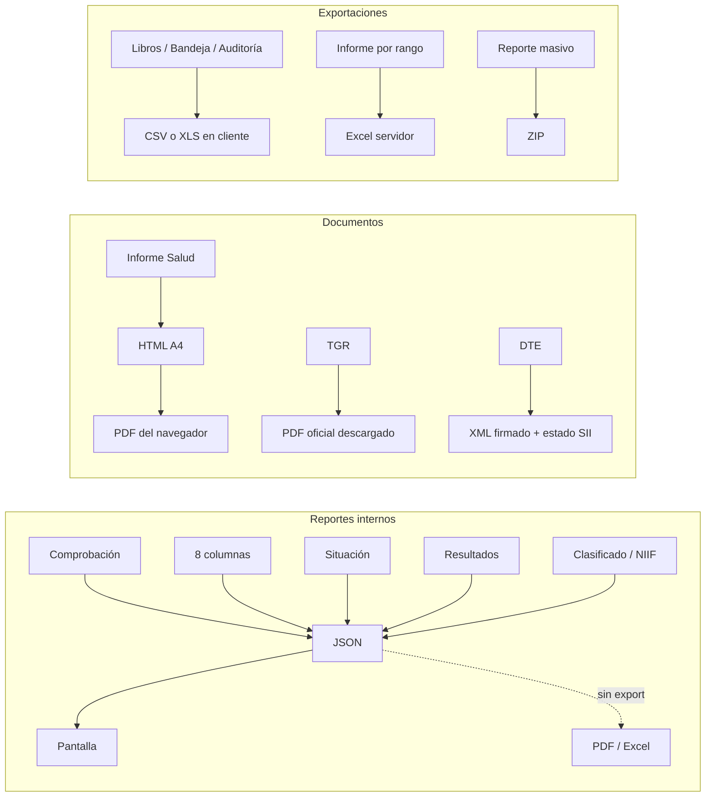

---

## 8. Autenticación y autorización

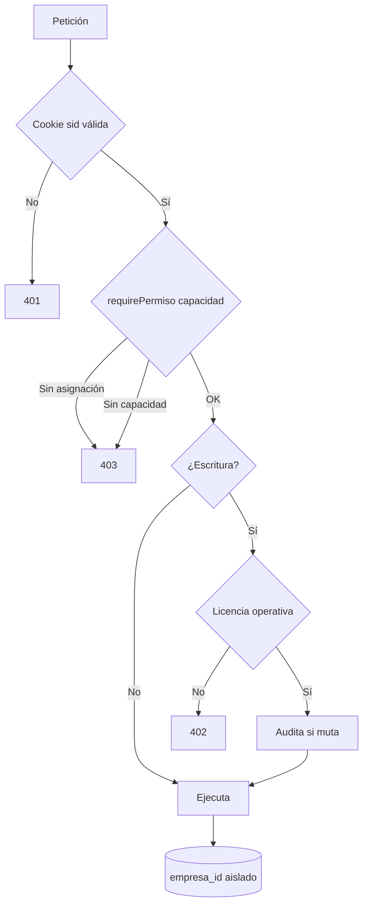

---

## 9. Entidades y relaciones (simplificado)

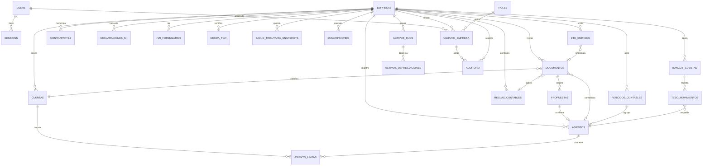

> El diagrama omite tablas CRM, portal, jobs y legacy para legibilidad; están inventariadas en `09`.

---

## 10. Dependencias entre módulos

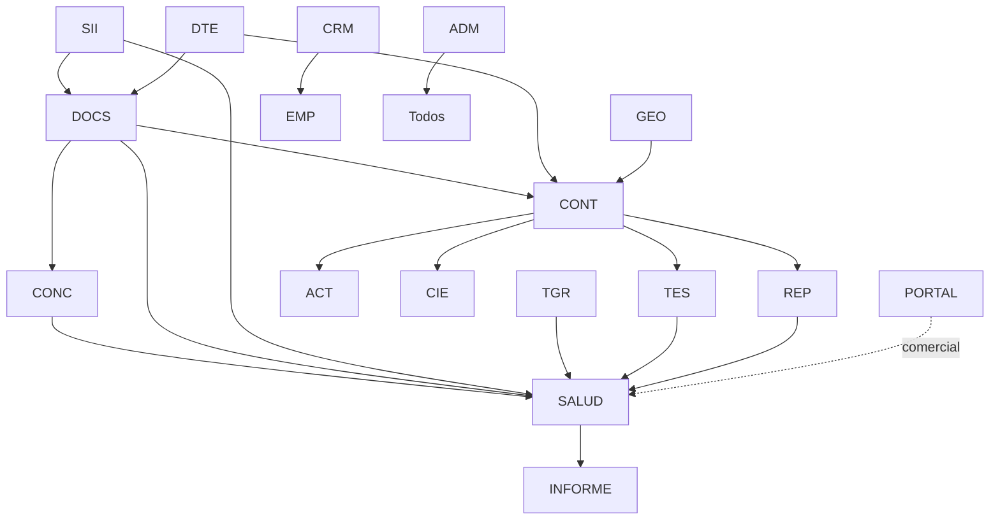

---

## 11. Errores, reintentos y recuperación

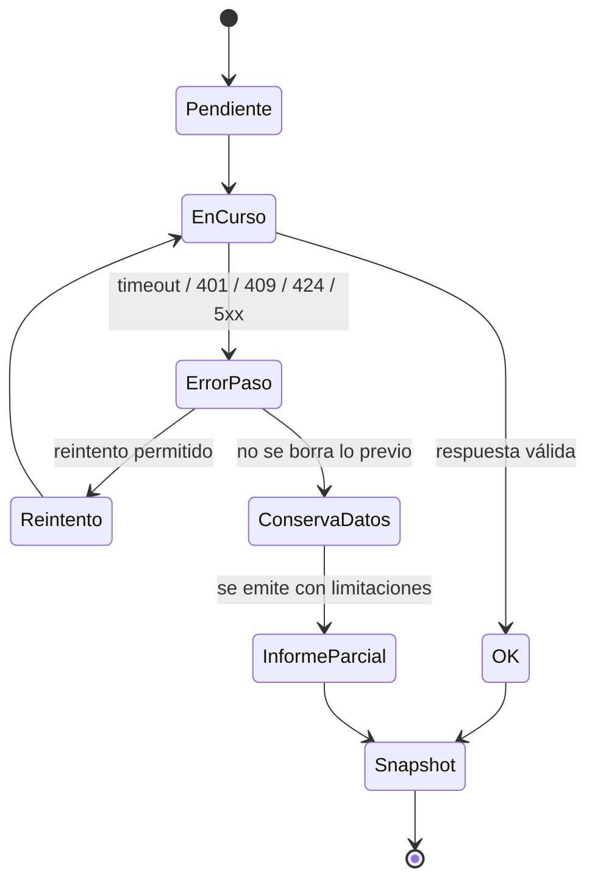

**Reglas:** un paso fallido no cancela los demás (test S2); la ficha previa se conserva; el tope de sesiones no se reintenta; el navegador ausente se detecta antes de autenticar.

---

## 12. Arquitectura funcional propuesta

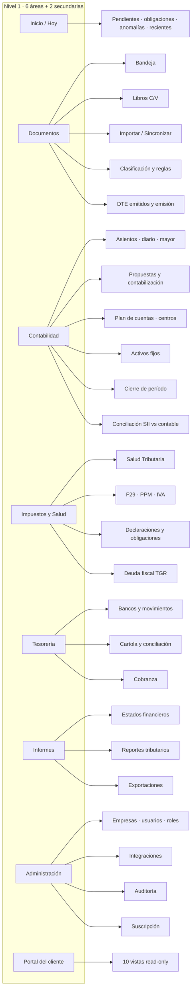

---

## 13. Comparación de navegación: actual vs objetivo

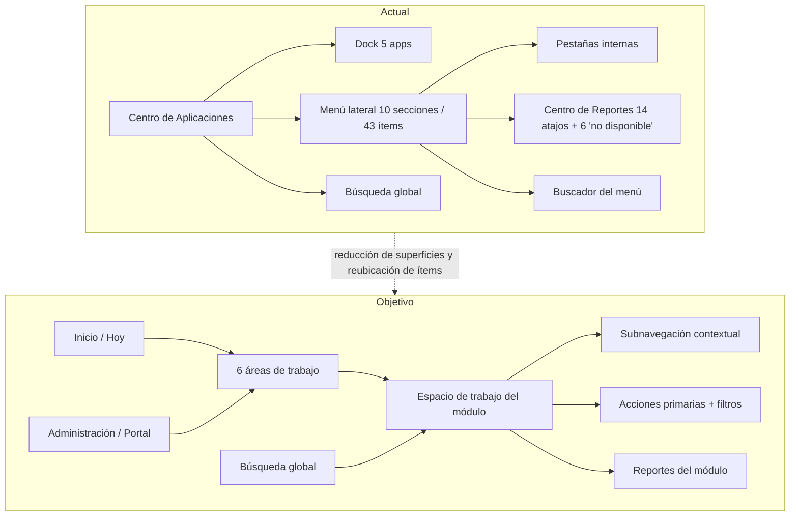
